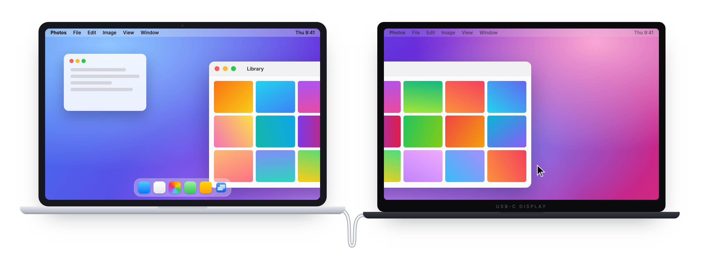
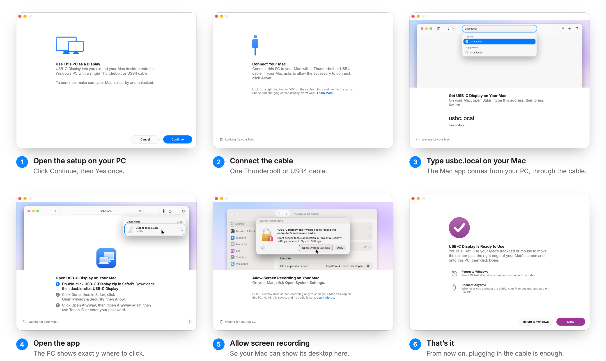

<h1 align="center">USB-C Display</h1>

<b>Your Windows laptop, as a second screen for your Mac.</b> One cable. No accounts. Free.

  <a href="https://github.com/UlisesAlzogaray/usbc-display/releases/latest/download/USB-C-Display-Setup-ARM64.exe"><b>Download for Windows on Snapdragon</b></a>
  &nbsp;·&nbsp;
  <a href="https://github.com/UlisesAlzogaray/usbc-display/releases/latest/download/USB-C-Display-Setup-x64.exe"><b>Download for Windows on Intel or AMD</b></a>

Not sure which one? On the PC, open Settings › System › About and look at "System type": ARM means Snapdragon.

---

## What it does

You have a Mac. You also have a Windows laptop sitting next to it, with a perfectly good screen. USB-C Display joins them.

Plug one cable between the two. Your Mac's desktop extends onto the laptop, exactly as if you had plugged in a real monitor. Drag windows across, keep notes open on one side while you work on the other, and use the laptop's own keyboard and trackpad to control the Mac.

Unplug the cable and the laptop is a Windows PC again. Plug it back in and your Mac desktop is there, right where you left it.

## Why it feels different

- **Sharp, every single pixel.** Most screen-sharing apps send video, which blurs text and smears colour when things move. USB-C Display sends the exact pixels your Mac draws. Nothing is guessed, nothing is compressed away.
- **Instant.** What happens on the Mac shows up on the laptop in 10 to 20 milliseconds, about one refresh of the screen. Typing, scrolling and dragging feel like a real monitor.
- **Just a cable.** No Wi-Fi, no internet, no account, no cloud. The picture travels only through the cable between your two computers, so nothing ever leaves your desk.
- **Looks like it belongs.** Text comes out the same size as on your MacBook, and colours are matched to the laptop's panel, so greys look grey and skin looks like skin.
- **One keyboard and trackpad, or two.** Use the laptop's keyboard and trackpad on the Mac, including accents and shortcuts. Your Mac's own trackpad keeps working too.
- **Set up once.** After the first time there is nothing to open and nothing to click. Plug in the cable, and the screen is there.

## Setting it up

Everything happens from one calm window on your PC. It walks you through both computers, shows you exactly where to click on the Mac, and moves on by itself as soon as you've done each step. You never need to download anything from the internet on your Mac: the Mac app comes from your PC, through the cable.

<picture>
  <source media="(prefers-color-scheme: dark)" srcset="assets/setup-steps-dark.png">
  
</picture>

It takes about five minutes. At the end, the setup window moves from the PC onto your new Mac screen, and you click **Done** on the Mac's side.

## What you need

- **A Mac** with Thunderbolt or USB4 ports: any Mac with Apple silicon, on macOS 12.3 or later.
- **A Windows 11 laptop** with a USB4 or Thunderbolt 4 port. Tested on a Snapdragon X laptop; the Intel and AMD version is newer and has had less testing.
- **One Thunderbolt or USB4 cable.** Look for a lightning bolt or "40" on the plugs. Most phone and charging cables are too slow.

Tip: keep each computer on its own charger. When one laptop powers the other through the same cable, the connection drops out more often.

## Everyday use

- **Start:** plug in the cable. The Mac desktop appears on the laptop.
- **Stop:** unplug the cable, or press **Ctrl + Alt + Esc** on the laptop.
- **Arrange the screens:** on the Mac, open System Settings › Displays and drag the new "USB-C Display" to the side of your Mac where the laptop sits.
- **Mac shortcuts on a Windows keyboard:** **Alt** (next to the space bar) is ⌘ Command, and the **Windows key** is ⌥ Option. Alt + Tab switches Mac apps.

## How it compares

There are good paid tools for second screens, and none of them do quite this: make a **Windows laptop** a **wired, pixel-exact** screen for a **Mac**, for free.

| | **USB-C Display** | Duet Display | Luna Display | Sidecar | spacedesk |
|---|---|---|---|---|---|
| **Price** | **Free** | $49.99 to $79.99 a year1 | $89.99 and up, hardware2 | Free, built into macOS | Free |
| **Windows laptop as a screen for a Mac** | **Yes** | Yes, with Duet Air or Pro | No: a Mac or an iPad is the screen | No: only an iPad | No: the main computer must run Windows3 |
| **Connection** | **One cable** | Wi-Fi for laptop-to-laptop4 | Hardware key plugged into the Mac | Cable or Wi-Fi | Wi-Fi or cable |
| **Picture** | **Exact pixels** | Compressed video | Compressed video | Compressed video | Compressed video |
| **Account needed** | **No** | Yes | No | Apple ID | No |
| **Open source** | **Yes, MIT** | No | No | No | No |

Prices and features as each company describes them, checked October 2026. 1 Duet Air and Duet Pro yearly plans on the US App Store. 2 Astropad's store. 3 spacedesk's own guide. 4 Duet's own blog describes its computer-to-computer mode as "completely wireless".

## Privacy and permissions

USB-C Display asks only for what it needs, and the setup explains each request in plain words before your computer asks.

| On | What it asks for | Why |
|---|---|---|
| Windows | One **Yes** when you start | To let the Mac reach the PC through the cable (nothing else on your network), and to restart the cable connection quietly if it ever gets stuck. |
| Mac | **Screen Recording** | To show your Mac desktop on the laptop. Nothing is saved and no audio is sent. |
| Mac | **Accessibility** (optional) | Only if you want the laptop's keyboard and trackpad to control the Mac. |
| Mac | **Login item** | So the Mac side is ready whenever you plug in the cable. |

Everything stays on the cable between your two computers. There is no server, no analytics and no account.

## Good to know

- **Windows may warn about an "unknown publisher"** the first time you open the setup. Click **More info**, then **Run anyway**. The setup isn't signed yet.
- **macOS asks you to approve the Mac app** in Privacy & Security, because it isn't notarized by Apple yet. The setup shows you exactly how, with an animation of each click.
- Both go away once the app is signed and notarized. That's first on the list below.

## Removing it

- **On the PC:** Settings › Apps › Installed apps › USB-C Display › Uninstall.
- **On the Mac:** turn off USB-C Display in System Settings › General › Login Items, then drag USB-C Display from Applications to the Trash.

## What's next

The idea behind USB-C Display is simple: the screens you already own should work together, and it should feel effortless and beautiful to set up. Every next step keeps that bar. Nothing ships until it is as calm and obvious to use as what's here today.

1. **No warnings at all.** A signed Windows installer and a notarized Mac app, so setup is just Continue, Allow and Done.
2. **The other way around.** Use your Mac as a second screen for your Windows PC, with the same one-cable setup and the same exact pixels.
3. **Any Windows PC.** Every Intel and AMD laptop with USB4 or Thunderbolt, desktops with Thunderbolt cards, and the other cable chips they use, each tested until it's as solid as the Snapdragon version.
4. **Android tablets, with touch.** Turn an Android tablet into a Mac screen you can touch: tap, scroll and pinch right on the Mac desktop, and draw with a stylus.

Ideas and requests are welcome in [Issues](https://github.com/UlisesAlzogaray/usbc-display/issues).

## For developers

How it works, how it's built and tested, and the full story of how it got here are in [**developers/**](developers/README.md).

## License

[MIT](LICENSE). Free to use, change and share.
